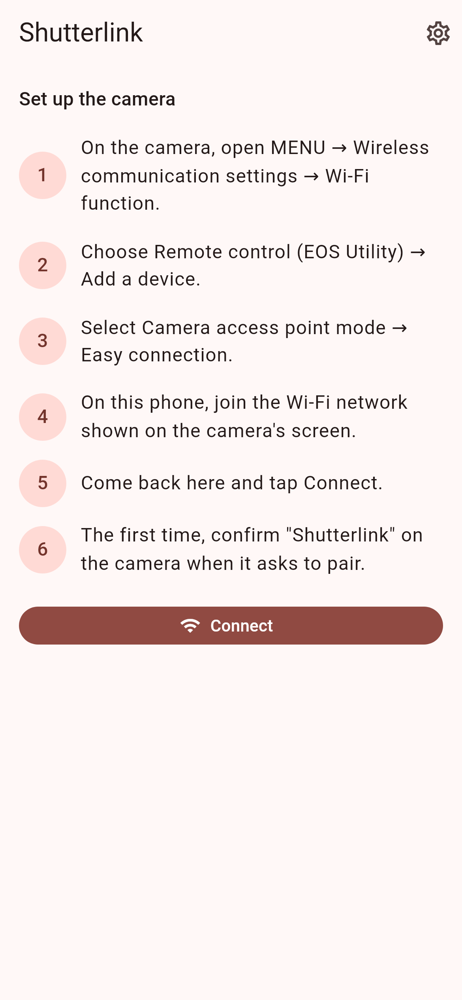
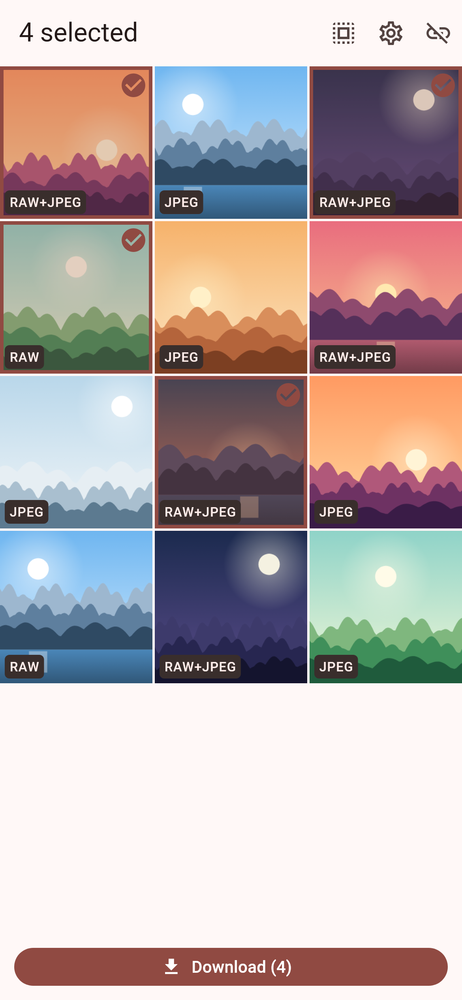
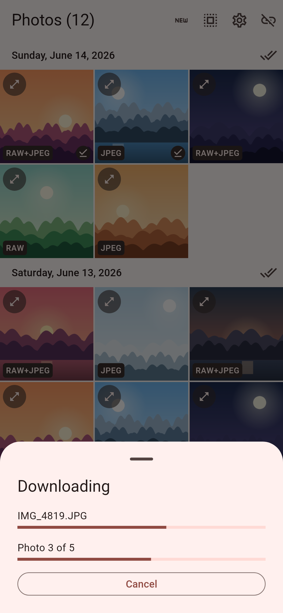
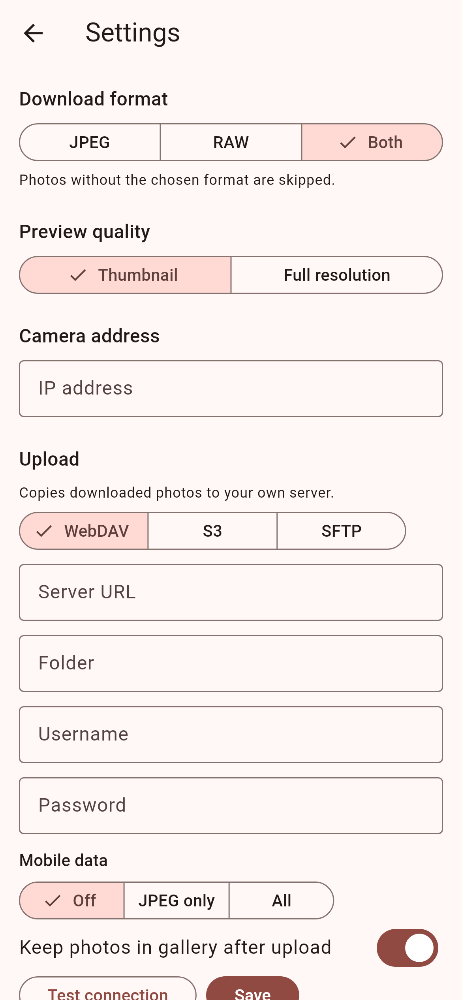
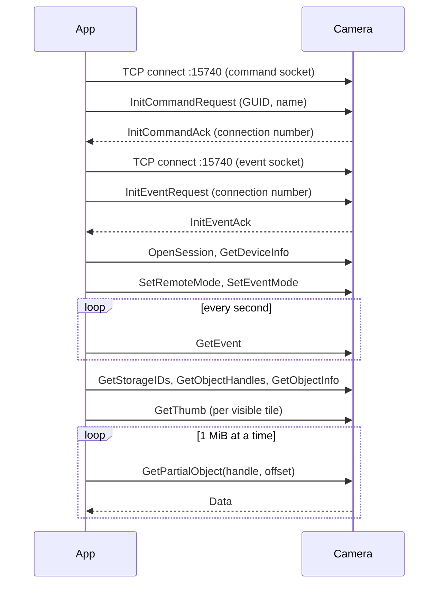

# Shutterlink

Download JPEG and CR3 photos from a Canon EOS R to your phone over the
camera's own Wi-Fi. No cloud, no Canon app, just PTP/IP written in pure Dart.

[](https://github.com/micheljung/shutterlink/actions/workflows/ci.yml)
[](LICENSE)

<p>
  
  
  
  
</p>

## Features

- Thumbnail grid of the memory card, newest first. A RAW+JPEG pair is one tile.
- Select some or all photos and download them as JPEG, RAW (CR3), or both.
- Per-file and overall progress. Cancel stops within one chunk.
- Interrupted downloads resume from the last received byte after reconnecting.
- Files are saved byte-identical to the originals: JPEGs to the gallery, CR3
  files to `Download/` on Android and to Photos as RAW on iOS.
- On Android the app binds to the camera's Wi-Fi, so traffic doesn't leave over
  mobile data when the camera network has no internet.
- A command-line probe (`bin/probe.dart`) to test the protocol from a laptop.

## Status

Early. Be aware of what has and hasn't been verified:

- The protocol layer and the app are tested against an in-process emulated
  camera (`test/ptpip/fake_camera.dart`). They have **not yet been verified on a
  real EOS R**, nor on physical Android or iOS devices.
- The Android debug APK builds in CI. The **iOS build has not been compiled
  yet**; the Swift code (RAW save to Photos) is untested.

Reports from real hardware are very welcome.

## Supported cameras

| Camera | Status |
|---|---|
| Canon EOS R | Targeted; untested on hardware |
| Other Canon EOS bodies with Wi-Fi "Remote control (EOS Utility)" | Untested; may work |

## Camera setup

1. On the camera, open **MENU → Wireless communication settings → Wi-Fi function**.
2. Choose **Remote control (EOS Utility) → Add a device**.
3. Select **Camera access point mode → Easy connection**.
4. On the phone, join the Wi-Fi network shown on the camera's screen.
5. Open Shutterlink and tap **Connect**.
6. The first time, confirm **"Shutterlink"** on the camera when it asks to pair.

Later connections skip step 6. The camera address defaults to the Wi-Fi
gateway; you can override it in Settings.

## Build and run

Requires [FVM](https://fvm.app) (the Flutter version is pinned in `.fvmrc`).

```bash
fvm install
fvm flutter pub get
fvm flutter run                 # on a connected device
fvm flutter build apk --debug   # Android APK
```

The Android build needs JDK 17.

## Probe CLI

`bin/probe.dart` runs the whole protocol from a laptop joined to the camera's
access point, without the app. It pairs, prints the device info and photo
counts, fetches one thumbnail, downloads one photo and reports the transfer
rate.

```bash
fvm dart run bin/probe.dart --host 192.168.1.2 --dump packets.txt
```

| Option | Default | Meaning |
|---|---|---|
| `--host` | (required) | Camera IP, usually the Wi-Fi gateway address |
| `--port` | `15740` | PTP/IP port |
| `--name` | `Shutterlink` | Name shown on the camera when pairing |
| `--guid-file` | `~/.shutterlink_guid` | Where the client GUID is stored |
| `--download-dir` | `.` | Where the downloaded photo goes |
| `--dump` | | Write a hex dump of every PTP/IP packet to this file |
| `--index` | `0` | Which photo to download, newest first |
| `--pair-timeout` | `60` | Seconds to wait for pairing to be confirmed |
| `-h`, `--help` | | Show usage |

| Exit code | Meaning |
|---|---|
| 0 | Success (or `--help`) |
| 64 | Invalid arguments or `--index` out of range |
| 69 | Camera unreachable or disconnected |
| 75 | Camera busy (another client is connected) |
| 77 | Pairing required: the camera doesn't know this GUID |

## How it works

The camera speaks PTP/IP: the USB Picture Transfer Protocol framed over TCP
port 15740. Everything protocol-related lives in `lib/ptpip/` and has no
Flutter dependency.

- **Two sockets.** A command socket carries requests, data and responses; an
  event socket carries camera events. The command handshake returns a
  connection number that the event handshake must echo.
- **Pairing by GUID.** The app generates a GUID once and always sends it with
  the name "Shutterlink". The camera remembers the pair after you confirm it;
  an unknown GUID is answered with `InitFail`, which the app turns into pairing
  instructions.
- **Canon EOS mode.** After `OpenSession` the client sends `SetRemoteMode`
  (0x9114) and `SetEventMode` (0x9115), then polls `GetEvent` (0x9116).
- **Listing and thumbnails** use standard `GetObjectHandles`, `GetObjectInfo`
  and `GetThumb`.
- **Downloads** use `GetPartialObject` in 1 MiB chunks, which is also what makes
  resuming possible. Larger blocks are known to fail on the EOS R.
- **Never `CloseSession`.** The EOS R misbehaves after it, so the client just
  closes the sockets.



## Project structure

```
bin/probe.dart          Command-line protocol probe
lib/
  ptpip/                PTP/IP client in pure Dart (packets, sockets, session, Canon ops)
  data/                 Settings, pairing identity, network binding, photo saving
  feature/
    connect/            Camera setup instructions and connection state
    gallery/            Thumbnail grid, RAW+JPEG grouping, thumbnail cache
    download/           Download planning, progress, resume
    settings/           Download format and camera address
android/app/src/main/kotlin/ch/micheljung/shutterlink/
                        Wi-Fi network binding, CR3 saving via MediaStore
ios/Runner/AppDelegate.swift
                        CR3 saving to Photos as RAW
test/
  ptpip/fake_camera.dart  In-process emulated EOS camera (TCP server)
  screenshots/            Renders the README screenshots
```

## Testing

```bash
fvm flutter test               # all tests
fvm flutter test --coverage    # lcov report in coverage/lcov.info
```

The PTP/IP layer is tested against `test/ptpip/fake_camera.dart`, a real TCP
server that emulates the camera: pairing and `InitFail`, listing, chunked
downloads, packets split across TCP segments, and dropped connections. CI
requires at least 90% line coverage for `lib/ptpip/`.

To regenerate the screenshots in `docs/screenshots/`:

```bash
fvm flutter test --tags screenshots --run-skipped
```

## Where files are saved

| | JPEG | CR3 |
|---|---|---|
| Android | Gallery, album `Shutterlink` (`Pictures/Shutterlink`) | `Download/Shutterlink/` |
| iOS | Photos | Photos, as the RAW resource of the photo (paired with its JPEG when both are downloaded). If that fails: the app's Documents folder, visible in the Files app |

## Limitations and roadmap

- Wi-Fi only; no USB.
- Photos only; videos are hidden.
- The camera address comes from the Wi-Fi gateway or a manual setting; there
  is no SSDP discovery.
- No Canon CCAPI support.
- No remote shooting or live view.

## Contributing

Issues and pull requests are welcome, especially results from real cameras.
A packet dump from the probe (`--dump`) helps a lot when something fails.
Before opening a pull request, run:

```bash
fvm dart format .
fvm flutter analyze
fvm flutter test
```

## Acknowledgements

- [libgphoto2](https://github.com/gphoto/libgphoto2): the PTP/IP implementation
  ([`camlibs/ptp2/ptpip.c`](https://github.com/gphoto/libgphoto2/blob/master/camlibs/ptp2/ptpip.c))
  and its Canon EOS notes in [`camlibs/ptp2`](https://github.com/gphoto/libgphoto2/tree/master/camlibs/ptp2).
- Julian Schroden's write-up on PTP/IP with Canon EOS cameras, especially
  [pairing and initializing a connection](https://julianschroden.com/post/2023-05-10-pairing-and-initializing-a-ptp-ip-connection-with-a-canon-eos-camera/).
- [petabyt/vcam](https://github.com/petabyt/vcam), a virtual PTP camera.
- [lclevy/miniPtp](https://github.com/lclevy/miniPtp), a minimal PTP/IP client for Canon cameras.

## License

[MIT](LICENSE) © 2026 Michel Jung

Canon and EOS are trademarks of Canon Inc. This project is not affiliated with
or endorsed by Canon.
