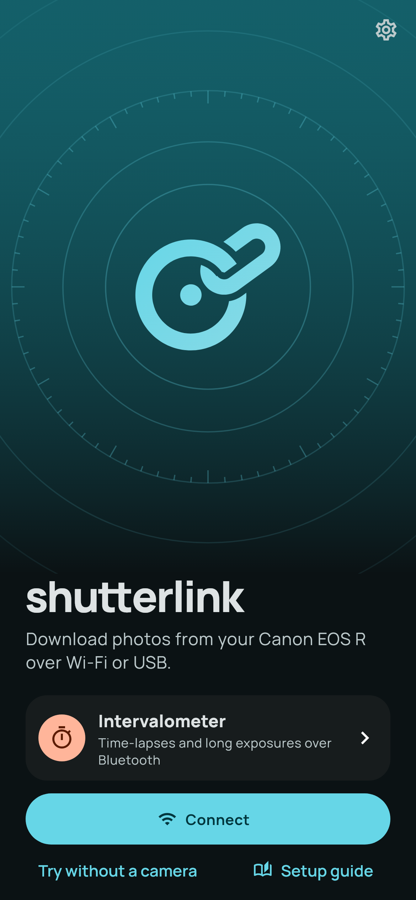
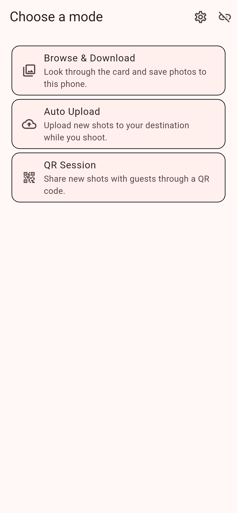
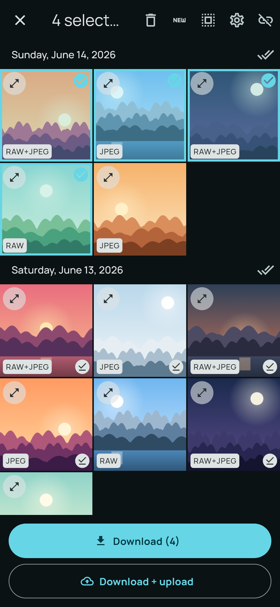
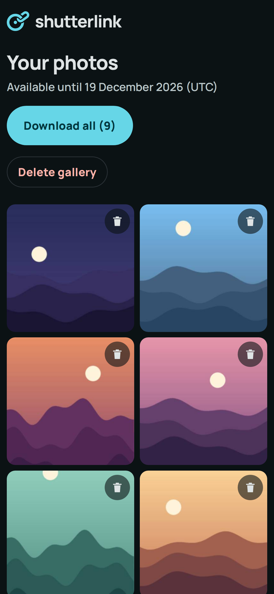
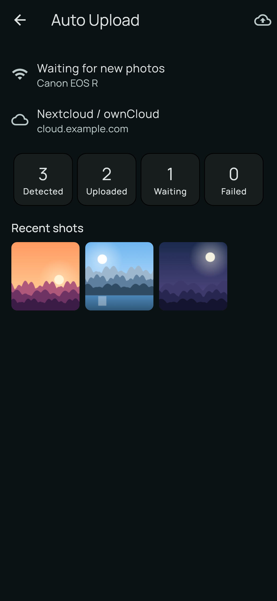
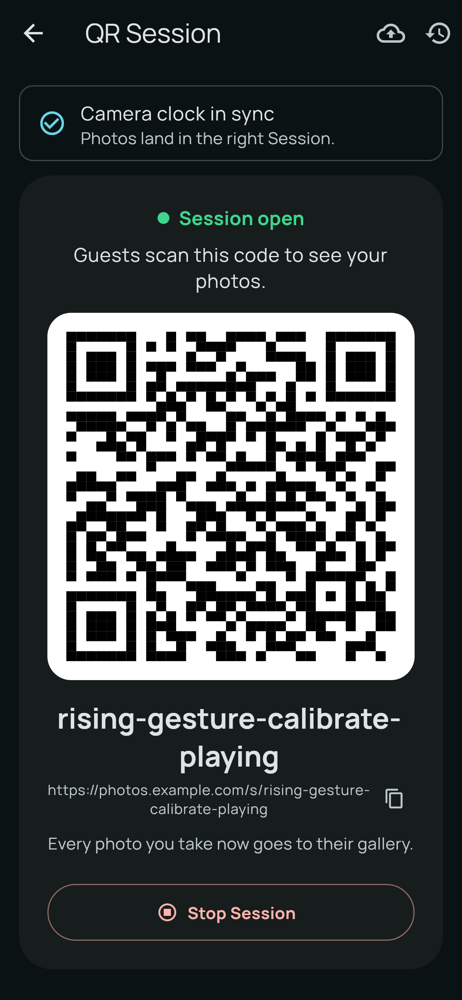

# Shutterlink

Get the photos off your Canon camera and onto your phone, back them up to
your own server as you shoot, and hand the people you photograph their
pictures before they walk away.

Shutterlink talks to the camera directly, over the camera's own Wi-Fi or a
USB cable. No Canon app, no account, and no cloud you don't own.

**[Download for Android](https://github.com/micheljung/shutterlink/releases/latest)**

  
  
  
  

## What you can do

After connecting, pick what you want to do.

### Browse & Download

See everything on the memory card, newest first and grouped by day, and
save the shots you want to your phone.

- **Pick quickly.** Long-press and drag to select a range, select a whole
  day at once, or tap **Select new** to get everything you haven't
  downloaded yet.
- **Look before you save.** Open any photo full screen, swipe through the
  card, and save the one you're looking at with **Download**. Portrait shots
  are shown upright.
- **JPEG, RAW or both.** RAW+JPEG pairs show as one photo. Files are saved
  exactly as the camera wrote them: JPEGs to your gallery, CR3 RAW files to
  `Download/` on Android and to Photos on iPhone.
- **Nothing twice.** Downloaded photos get a badge and are skipped next
  time.
- **Interruptions don't cost you.** If the connection drops, tap **Resume**
  once the camera is back, and the download continues where it stopped.
- **Free up the card.** Delete photos from the camera, with a warning that
  counts the ones you haven't saved yet.

 

### Auto Upload to your own server

Every new shot goes straight to your own storage while you keep shooting,
with no cable and no sorting afterwards.

- **Your storage, your choice:** Nextcloud/ownCloud or any WebDAV server,
  Backblaze B2, AWS S3, Cloudflare R2 or other S3-compatible storage, a
  Hetzner Storage Box or any SFTP server, or Immich. A guided setup asks only
  for what your provider needs.
- **Photos already on the card** can go along too. Shutterlink asks when you
  start.
- **Keeps going in the background** on Android, so you can pocket the phone.
  On iPhone, keep the app open.
- **Mind your data plan.** Choose whether uploads use mobile data never, for
  JPEGs only, or always.
- **Phone storage stays free.** Turn off **Keep photos in gallery after
  upload**, and a photo is removed from the phone once your server has it.
- **Safe by default.** Passwords and keys stay in the phone's secure storage.
  The first time you connect to a server with a self-signed certificate or
  an SFTP host, you confirm its fingerprint, and Shutterlink refuses to
  upload if it ever changes.

 

### QR Session: everyone gets their photos

Shooting portraits at an event, a party or on the street? Start a QR Session,
let the person scan the code, and every photo you take of them shows up in
their own private web gallery a few seconds later. They need no app and no
account.

- **Live.** New photos appear in the gallery while the guest watches.
- **Easy to keep.** Guests swipe and zoom through full-screen photos and
  download single photos or all of them at once.
- **One gallery per person.** Each Session has its own link and a readable
  code such as `apple-banana-cherry-delta`. Photos taken while no Session is
  running are never shared.
- **Pick up where you left off.** If the app or the camera drops out, the
  Session comes back on its own when you reconnect within 30 minutes.
- **Optional tips.** The gallery can show tip buttons, for example for
  PayPal or TWINT.
- **Self-hosted.** Galleries live on your own small server and are deleted
  after 30 days by default. See [Set up QR Sessions](#set-up-qr-sessions).

 

### And also

- **Try it without a camera.** **Try without a camera** on the start screen
  turns your phone's camera into a demo camera, so you can try every mode.
- **Wi-Fi or cable.** Join the camera's Wi-Fi, or plug it in with a USB
  cable. On your home Wi-Fi, Shutterlink finds the camera by itself.
- **Your mobile data stays yours.** On Android, camera traffic stays on the
  camera's Wi-Fi and never goes out over mobile data.

## Supported cameras

| Camera | Status |
|---|---|
| Canon EOS R | Works on Android, over Wi-Fi and USB |
| Other Canon EOS cameras with Wi-Fi "Remote control (EOS Utility)" | Not tried yet; likely to work |
| Other cameras that offer PTP ("PTP" or "PC connection" USB mode) | Basic support: JPEG only, and new shots are noticed a little later |

The iPhone app builds, but hasn't been tried with a real camera yet, over
Wi-Fi or USB. Reports from other cameras and from iPhones are very
welcome; see [Contributing](#contributing).

## Get started

### Install

Download the APK from the
[latest release](https://github.com/micheljung/shutterlink/releases/latest)
and open it on your Android phone. On iPhone, build the app from source; see
[docs/development.md](docs/development.md).

### Connect over Wi-Fi

1. On the camera, open **MENU → Wireless communication settings → Wi-Fi function**.
2. Choose **Remote control (EOS Utility) → Add a device**.
3. Select **Camera access point mode → Easy connection**.
4. On the phone, join the Wi-Fi network shown on the camera's screen.
5. Open Shutterlink and tap **Connect**.
6. The first time, confirm **"Shutterlink"** on the camera when it asks to pair.

Later connections skip step 6.

**Camera on your home Wi-Fi instead?** Join the same network and tap
**Connect**: Shutterlink finds the camera, and asks which one if there are
several. To pair, select the saved connection under **Remote control (EOS
Utility)** on the camera, press **OK** at **Start pairing devices**, then tap
**Connect** and confirm **"Shutterlink"**. The EOS R asks for this OK again
after it has left the network, for example after auto power off.

### Connect over USB

1. Plug the camera into the phone with a USB cable and switch it on.
2. **Android:** allow Shutterlink to access the camera and tick **Always
   open**, so Shutterlink reconnects by itself after you re-plug the cable.
3. **iPhone (experimental):** allow Shutterlink to control the camera.

No Wi-Fi or pairing is needed. Plugging in a Canon camera takes over from a
Wi-Fi connection, and tapping **Connect** switches back.

### Set up Auto Upload

Open **Settings → Upload → Set up upload**, pick your provider and fill in
the few fields it asks for. Then connect the camera and choose **Auto
Upload**. Nothing is uploaded anywhere until you set up a destination.

For Immich, create an API key with the `asset.upload` permission. Photos go
to your timeline, not an album, and photos Immich already has are skipped.

### Set up QR Sessions

1. Run the Sessions server, for example with the ready-made Docker image
   `ghcr.io/micheljung/shutterlink-server`, behind HTTPS. See
   [`server/README.md`](server/README.md).
2. In the app, open **Settings → Sessions → Connect Sessions** and enter your
   server's address and upload token.
3. Connect the camera and choose **QR Session**. Show the QR code, or tap the
   Session Code to show it large. **Stop Session** and **Start new Session**
   are on the same screen, and past Sessions are listed under **Past
   Sessions**.

Shutterlink reads the camera's clock to match each photo to the right
Session, and corrects for a camera clock that is off, without changing it.
If a camera doesn't report its time, tap **Sync clock** and take a photo.

## Where photos are saved

| | JPEG | RAW (CR3) |
|---|---|---|
| Android | Gallery, album `Shutterlink` | `Download/Shutterlink/` |
| iPhone | Photos | Photos, together with its JPEG. If that fails: the Files app, in Shutterlink's folder |

Photos from a QR Session only go to your Sessions server, not to the phone
or to your Auto Upload destination.

## Good to know

- Photos only. Videos are not shown.
- While the phone is connected to the camera's Wi-Fi, uploads need another
  connection to the internet, such as mobile data. QR Sessions use it
  automatically; for Auto Upload, allow mobile data in its settings.
- Photos reach a QR Session within a few seconds of the shot.
- If you change the camera's clock (or it resets), connect once or tap
  **Sync clock** before shooting the next Session, so photos aren't matched
  to the wrong person.
- No remote shooting or live view.

## Contributing

Issues and pull requests are welcome, especially reports from real cameras.
To build, test or add support for another camera, see
[docs/development.md](docs/development.md).

## Acknowledgements

- [libgphoto2](https://github.com/gphoto/libgphoto2): the PTP/IP implementation
  ([`camlibs/ptp2/ptpip.c`](https://github.com/gphoto/libgphoto2/blob/master/camlibs/ptp2/ptpip.c))
  and its Canon EOS notes in [`camlibs/ptp2`](https://github.com/gphoto/libgphoto2/tree/master/camlibs/ptp2).
- Julian Schroden's write-up on PTP/IP with Canon EOS cameras, especially
  [pairing and initializing a connection](https://julianschroden.com/post/2023-05-10-pairing-and-initializing-a-ptp-ip-connection-with-a-canon-eos-camera/).
- [petabyt/vcam](https://github.com/petabyt/vcam), a virtual PTP camera.
- [lclevy/miniPtp](https://github.com/lclevy/miniPtp), a minimal PTP/IP client for Canon cameras.
- Session Codes use the [EFF large wordlist](https://www.eff.org/dice) by the
  Electronic Frontier Foundation, licensed under
  [CC BY 3.0 US](https://creativecommons.org/licenses/by/3.0/us/).

## License

[MIT](LICENSE) © 2026 Michel Jung

Canon and EOS are trademarks of Canon Inc. This project is not affiliated with
or endorsed by Canon.
