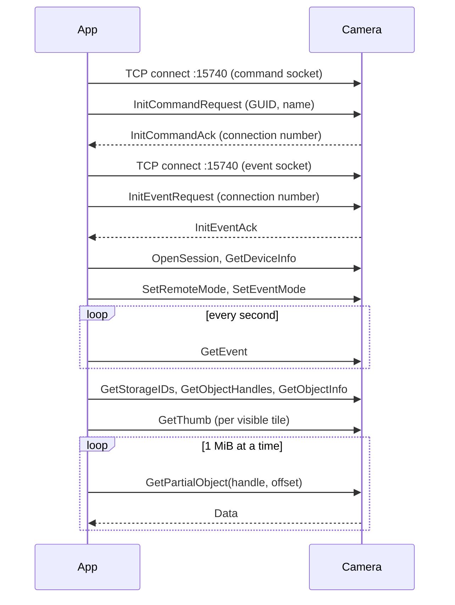

# Developing Shutterlink

For what the app does and how to use it, see the [README](../README.md).
Releases are described in [RELEASING.md](../RELEASING.md), the Sessions
server in [`server/README.md`](../server/README.md), and the EOS R's observed
behaviour in [eos-r-hardware.md](eos-r-hardware.md).

## Build and run

Requires [FVM](https://fvm.app) (the Flutter version is pinned in `.fvmrc`).

```bash
fvm install
fvm flutter pub get
fvm flutter run                 # on a connected device
fvm flutter build apk --release # Android APK
```

The Android build needs JDK 17.

## Probe CLI

`bin/probe.dart` runs the whole protocol from a laptop joined to the camera's
access point, without the app. It pairs, prints the device info and photo
counts, fetches one thumbnail, downloads one photo and reports the transfer
rate. It saves the thumbnail next to the photo (`<name>.thumb.jpg`) and
prints the thumbnail's stored size and both EXIF orientations, which shows
whether the camera turns its thumbnails upright.

```bash
fvm dart run bin/probe.dart --host 192.168.1.2 --dump packets.txt
```

| Option | Default | Meaning |
|---|---|---|
| `--host` | (required) | Camera IP, usually the Wi-Fi gateway address |
| `--clock` | off | Print the device properties and the camera clock, then exit (no download) |
| `--watch-events` | off | Skip download; log Canon GetEvent records (type, size, hex) every second until Ctrl-C |
| `--port` | `15740` | PTP/IP port |
| `--name` | `Shutterlink` | Name shown on the camera when pairing |
| `--guid-file` | `~/.shutterlink_guid` | Where the client GUID is stored |
| `--download-dir` | `.` | Where the downloaded photo goes |
| `--dump` | | Write a hex dump of every PTP/IP packet to this file |
| `--index` | `0` | Which photo to download, newest first |
| `--pair-timeout` | `60` | Seconds to wait for pairing to be confirmed |
| `-h`, `--help` | | Show usage |

| Exit code | Meaning |
|---|---|
| 0 | Success (or `--help`) |
| 64 | Invalid arguments or `--index` out of range |
| 69 | Camera unreachable or disconnected |
| 75 | Camera busy (another client is connected) |
| 77 | Pairing required: the camera doesn't know this GUID |

## How it works

The camera speaks PTP/IP: the USB Picture Transfer Protocol framed over TCP
port 15740. Everything protocol-related lives in `lib/ptpip/` and has no
Flutter dependency.

- **Two sockets.** A command socket carries requests, data and responses; an
  event socket carries camera events. The command handshake returns a
  connection number that the event handshake must echo.
- **Pairing by GUID.** The app generates a GUID once and always sends it with
  the name "Shutterlink". The camera remembers the pair after you confirm it;
  an unknown GUID is answered with `InitFail`, which the app turns into pairing
  instructions.
- **Canon EOS mode.** After `OpenSession` the client sends `SetRemoteMode`
  (0x9114) and `SetEventMode` (0x9115), then polls `GetEvent` (0x9116).
- **Listing and thumbnails** use standard `GetObjectHandles`, `GetObjectInfo`
  and `GetThumb`.
- **Downloads** use `GetPartialObject` in 1 MiB chunks, which is also what makes
  resuming possible. libgphoto2 notes that the EOS R rejects larger blocks.
- **Deleting** uses standard `DeleteObject` (0x100B), once per file, and only
  when the camera lists it in `DeviceInfo`. A protected file or a locked card
  is refused with `Object_WriteProtected`, `Store_Read_Only` or
  `Access_Denied`, reported, not retried. Not yet tried on a real EOS R.
- **Never `CloseSession`.** libgphoto2 flags the EOS R as failing later
  operations after it, so the client restores remote mode and closes the
  sockets instead.



Over USB the same PTP operations travel in USB containers instead of PTP/IP
packets: through the bulk endpoints on Android (`lib/usb/`), and as whole
transactions through ImageCaptureCore on iOS.

### Adding a camera model

Vendor behaviour lives in a camera profile: Canon's is in `lib/ptp/canon/`.
A new maker or model is one profile file plus one entry in
`lib/ptp/profile_registry.dart`. A camera no profile matches still works
through the generic PTP profile. The Android USB filter
(`android/app/src/main/res/xml/usb_device_filter.xml`) matches the PTP
still-image class only, so any PTP camera offers to open Shutterlink and a
new maker's camera needs no edit there. It deliberately lists no vendor IDs,
which would also match that maker's printers and scanners.

## Project structure

```
bin/probe.dart          Command-line protocol probe
lib/
  ptp/                  Transport-independent PTP: session, client, camera profiles
  ptp/canon/            Canon EOS profile
  ptpip/                PTP/IP transport in pure Dart (packets, sockets)
  usb/                  PTP over USB, and the Android and iOS USB bridges
  data/                 Settings, pairing identity, network binding, SSDP discovery,
                        download history, photo saving
  feature/
    connect/            Camera setup instructions and connection state
    gallery/            Thumbnail grid, day sections, range selection, thumbnail cache
    preview/            Full-screen preview
    download/           Download planning, progress, resume
    history/            Downloaded-photo marks
    sessions/           Sessions, clock sync, attribution, QR code, upload status
    settings/           Download format, camera address, upload and
                        Sessions setup
android/app/src/main/kotlin/ch/micheljung/shutterlink/
                        Wi-Fi network binding, multicast lock, CR3 saving via MediaStore
ios/Runner/AppDelegate.swift
                        CR3 saving to Photos as RAW
test/
  ptpip/fake_camera.dart  In-process emulated EOS camera (TCP server)
  screenshots/            Renders the README screenshots
  e2e/                    Sessions end to end: fake camera → app → local server
server/                 Self-hostable Sessions gallery server (Dart, shelf)
tool/                   Wordlist generator, demo photos and the guest gallery screenshot
docs/fdroid/            Copy of the F-Droid build recipe
fastlane/metadata/      F-Droid store listing
```

## Testing

```bash
fvm flutter test               # all tests
fvm flutter test --coverage    # lcov report in coverage/lcov.info
(cd server && fvm dart test)   # Sessions server
```

The PTP/IP layer is tested against `test/ptpip/fake_camera.dart`, a real TCP
server that emulates the camera: pairing and `InitFail`, listing, chunked
downloads, packets split across TCP segments, and dropped connections. CI
requires at least 90% line coverage for `lib/ptpip/`.

The SFTP tests start a local OpenSSH `sshd` and are skipped by default. CI runs
them with `--tags "sftp || sftp-root" --run-skipped`; `lib/upload/` must reach
90% line coverage across both runs (`tool/check_coverage.sh`).

To regenerate the app screenshots in `docs/screenshots/` (dark theme; add
`--dart-define=SCREENSHOTS_LIGHT=true --dart-define=SCREENSHOTS_DIR=<dir>` to
review the light theme elsewhere):

```bash
fvm flutter test --tags screenshots --run-skipped
```

The guest gallery screenshot (`guest_gallery.png`) comes from a running
Sessions server with demo photos, captured by headless Chromium. It needs
`curl`, Python 3 with Pillow and Chromium (`CHROME=<binary>` if it isn't on
`PATH` as `chromium`):

```bash
tool/screenshot_guest_gallery.sh
```

The brand assets in `assets/brand/` are rendered from the logo in
`lib/brand/`. After changing it, regenerate them and the platform icons and
splash screens:

```bash
fvm flutter test --tags brand-assets --run-skipped
fvm dart run flutter_launcher_icons
fvm dart run flutter_native_splash:create
```

`flutter_launcher_icons` also rewrites `ios/Runner.xcodeproj/project.pbxproj`;
discard that change.

## Contributing

Issues and pull requests are welcome, especially results from real cameras.
A packet dump from the probe (`--dump`) helps a lot when something fails.
Before opening a pull request, run:

```bash
fvm dart format .
fvm flutter analyze
fvm flutter test
```
